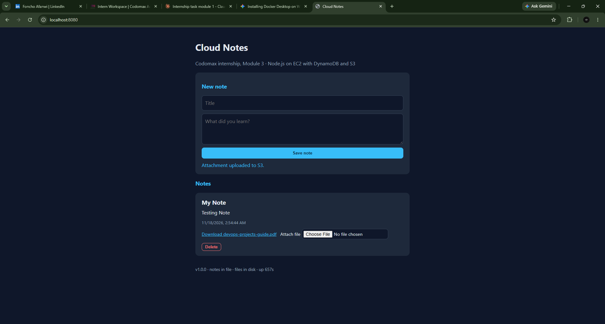

# Docker & Containerization (Module 4)

Codomax Digital Solutions internship, Module 4 (Day 16 to Day 20).
Author: Foncho Afanwi Ngwa ([@fonchoafa](https://github.com/fonchoafa))

This repository containerizes **Cloud Notes**, the Node.js web app from [Module 3](https://github.com/fonchoafa/cloud-web-app-deployment), and runs it with Docker Compose behind an nginx reverse proxy.

**Flow:** Source Code → Dockerfile → Image → Container → Docker Compose → Running Application

## Architecture

```
 Browser --> localhost:8080 --> [ web: nginx ] --> [ app: Node.js :3000 ] --> volume "notes-data" (/data)
                                  published           private, not published      notes.json + uploads/
                      all on the private Docker network "backend"
```

| Piece | What it shows |
| --- | --- |
| [app/Dockerfile](app/Dockerfile) | Multi-stage build, small `alpine` base, layer caching, non-root user, health check |
| [app/.dockerignore](app/.dockerignore) | Keeps secrets, tests and `node_modules` out of the image |
| [docker-compose.yml](docker-compose.yml) | Two services, a private network, a named volume, environment variables, resource limits |
| [nginx/default.conf](nginx/default.conf) | Reverse proxy to the app by service name |
| [examples/Dockerfile.naive](examples/Dockerfile.naive) | A deliberately bad Dockerfile to compare image size and build cache |

## Quick start

Requires [Docker Desktop](https://www.docker.com/products/docker-desktop/).

```powershell
copy .env.example .env          # then set ADMIN_KEY to your own value
docker compose up -d --build
docker compose ps               # both services running, app "healthy"
```

Open http://localhost:8080. Stop with `docker compose down` (add `-v` to delete the saved data).

## Documentation

| Doc | Content |
| --- | --- |
| [docs/01-containers-and-docker-architecture.md](docs/01-containers-and-docker-architecture.md) | Containers vs virtual machines, Docker architecture, images and layers |
| [docs/02-docker-commands.md](docs/02-docker-commands.md) | Hands-on Docker commands for images and containers |
| [docs/03-dockerfile-networking-volumes-compose.md](docs/03-dockerfile-networking-volumes-compose.md) | The Dockerfile explained and optimized, networking, volumes and persistent data, environment variables, Compose |
| [docs/04-run-guide.md](docs/04-run-guide.md) | Step-by-step run, verification, troubleshooting and clean up on Windows |
| [scripts/smoke-test.ps1](scripts/smoke-test.ps1) | Automated checks of the running stack |
| [screenshots/](screenshots/) | Evidence from my run (see checklist) |

## Objectives covered

- [x] Containers vs virtual machines, Docker architecture, images, containers and Dockerfile optimization
- [x] Docker commands, container networking, volumes, persistent data, environment variables and Docker Compose
- [x] Containerize a web application: source code, Dockerfile, image, container, Docker Compose, running application

## What I changed in the app

The app is the Module 3 code with two small additions so it works well in a container:

- `NOTES_FILE`: keep notes in a JSON file so a Docker volume can persist them (4 new tests; 11 tests in total).
- `TRUST_PROXY`: a setting for which proxy address to trust for the client IP, because nginx is not on `localhost` any more.

The app still supports DynamoDB and S3 through `TABLE_NAME` and `BUCKET_NAME`.

## Security notes

- No secrets in Git or in the image: `.env` is git-ignored and `.dockerignore` excludes it.
- The container runs as the non-root `node` user, with a read-only filesystem, all Linux capabilities dropped and memory and CPU limits.
- Only nginx is published to the PC; the app port is reachable only on the private Docker network.

## Lessons learned

- **A smaller image matters.** My deliberately naive Dockerfile produced a 1.68 GB image (416 MB to download), while the optimized multi-stage alpine image is 282 MB (64.7 MB to download), about 6 times smaller. The naive base image also took around 18 minutes to download on my connection.
- **Containers forget, volumes remember.** I removed both containers with `docker compose down`, started them again, and my notes were still there because they live in the `notes-data` volume, not in the container.
- **Only the proxy should be exposed.** nginx reaches the app by its service name `app`, but `localhost:3000` from my PC is refused, which is what I wanted.
- **Things that went wrong at first:** I ran the commands from the wrong folder after unzipping, and `docker compose up` failed until Docker Desktop was running. Next time I would check `docker version` first.
- **What I would add next:** a CI pipeline that builds and scans the image, which is the next module.

## Evidence

| Check | Screenshot |
| --- | --- |
| Docker installed and working | [01-docker-version.png](screenshots/01-docker-version.png) |
| Naive vs optimized image size | [02-image-comparison.png](screenshots/02-image-comparison.png) |
| Compose running, app healthy | [03-compose-up.png](screenshots/03-compose-up.png) |
| App in the browser | [04-app-in-browser.png](screenshots/04-app-in-browser.png) |
| Networking: only nginx is exposed | [05-networking.png](screenshots/05-networking.png) |
| Notes survive a restart (volume) | [06-volume-persistence.png](screenshots/06-volume-persistence.png) |
| JSON logs | [07-logs.png](screenshots/07-logs.png) |
| Non-root user and read-only filesystem | [08-security.png](screenshots/08-security.png) |
| Resource limits | [09-stats.png](screenshots/09-stats.png) |
| Automated smoke test | [10-smoke-test.png](screenshots/10-smoke-test.png) |



## Clean up

```powershell
docker compose down -v
docker image prune -a
```
